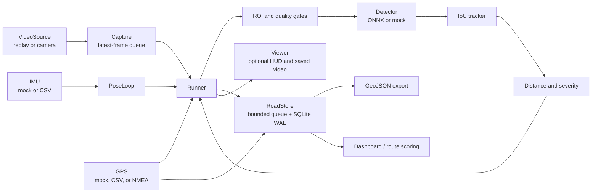

# Architecture

## System overview

The application is a local, replay-first road-survey pipeline. It detects potholes in
the road ROI, estimates their distance and severity, records the GPS path and
pothole locations, and can export the result as a provider-independent GeoJSON
FeatureCollection. The critical vision path does not wait for database writes.

## Runtime stages

1. **Video capture**: `VideoSource` reads a replay file or camera. `Capture` keeps
   the newest frame in a one-item queue, dropping stale frames rather than allowing
   latency to grow.
2. **Pose and ROI gating**: `PoseLoop` supplies the pose nearest the frame capture
   timestamp. The runner derives a horizon/road ROI and rejects frames whose pose,
   road appearance, blur, texture, saturation, or edge checks are not acceptable.
   It reports `ROAD_NOT_VISIBLE` or `DEGRADED` state transitions.
3. **Detection**: the detector runs only on the accepted ROI. The configured
   `detector.kind` selects the mock detector or the ONNX model, with confidence,
   NMS IoU, and maximum box-area thresholds.
4. **Tracking**: detections are associated with short-lived tracks using configured
   IoU/center matching. Confirmation requires `confirm_n` sightings in the
   `confirm_m`-frame window; a track is logged at most once.
5. **Geometry and severity**: the bottom of the box, camera height, focal length,
   and pitch produce a flat-ground monocular distance estimate. Estimated width,
   confidence, and darkness map to `LOW`, `MEDIUM`, or `HIGH`.
6. **Persistence**: valid GPS path points are queued to `RoadStore`. Confirmed
   potholes are queued with timestamp, coordinates, confidence, severity, and
   distance. A pothole within `storage.dedup_radius_m` updates the existing row
   and increments `seen`.
7. **Presentation/export**: the optional viewer draws ROI, boxes, track IDs,
   confidence, distance, severity, state, FPS, and latency. The store can export
   path and pothole features to GeoJSON for mapping.

## Inputs and operating modes

| Input | Supported modes | Configuration/CLI |
|---|---|---|
| Video | file replay or camera index | `camera.source`, `--source` |
| IMU | mock or CSV | `imu.source`, `--mock-imu` |
| GPS | mock, CSV, or serial NMEA | `gps.source`, `--gps-source`, `--gps-port`, `--gps-file` |
| Detector | mock or ONNX | `detector.kind`, `detector.model` |

The default configuration uses mock IMU/GPS and the ONNX detector. The mock
detector is intended for development and replay tests; it is not a trained model.
For live NMEA input, the optional `gps` extra installs `pyserial`.

## Persistence and derived outputs

SQLite stores:

- `path_points(ts, lat, lon, speed_kmh, source, hdop, sats)`
- `potholes(id, ts, lat, lon, max_conf, severity, dist_m, seen)`

`RoadStore` uses a bounded queue and a writer thread with SQLite WAL mode. Path
points may be dropped if the queue is full; pothole records are retained by
evicting an older queued path point when necessary. GPS points are accepted only
when the fix is valid and HDOP is at most the configured/default threshold of 4.0.

`export_geojson` emits one `LineString` path feature and one `Point` feature per
deduplicated pothole. `stats` derives travelled distance, weighted risk per km,
and a road score. `routing.safest` scores candidate coordinate paths by proximity
to stored potholes, with higher scores representing lower risk.

## Timing and back-pressure

| Stage/metric | Configured target |
|---|---:|
| Detector scheduling budget | `decision.latency_p95_ms` (180 ms default) |
| Capture queue | 1 frame |
| Telemetry queue | 200 records by default |
| Road-store queue | 500 records |

The rolling end-to-end p95 is fed to `Scheduler`. When it exceeds the configured
budget, inference is reduced to every second frame; it resumes when p95 falls
below 75% of the budget. `run_loop` returns frame count, capture drops, p50/p95
latency, and detector p95 latency for the summary line.

## Calibration and limitations

Distance and width are engineering estimates based on a flat road plane and the
configured camera height, focal length, and pitch. Camera mounting changes require
recalibration. Blur, water, glare, shadows, and unusual road surfaces can affect
the quality gates and detector. The replay pipeline is not field-safety
validation.
