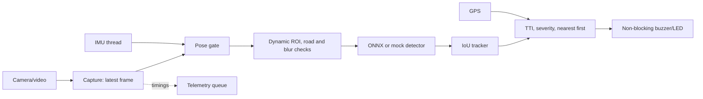

# Architecture

| Stage | Target (ms) |
|---|---:|
| Capture queue | 5 |
| Pose, ROI and quality checks | 3 |
| Detector | 80 |
| Tracker and decision | 5 |
| Warning dispatch | 10 |
| End-to-end p50 | <= 120 |
| End-to-end p95 | <= 180 |

The detector runs only on the ROI. The queue has size one so the inference loop takes the newest frame. A rolling p95 above the configured budget enables every-second-frame inference until it recovers. IMU gating sets `ROAD_NOT_VISIBLE`; failed ROI quality checks set `DEGRADED`.
